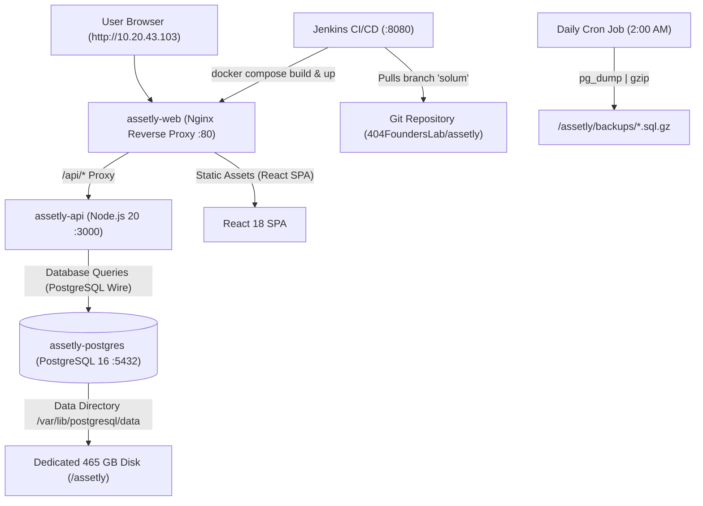

# Assetly — Solum Group On-Premises Complete Setup & Operations Guide

This document is the master step-by-step record of everything configured and executed to deploy, secure, and operate **Assetly** on the on-premises virtual machine (`10.20.43.103`) for **Solum Technologies India Private Limited**.

---

## 1. System Architecture Overview



### Server & Resource Specifications
* **Host VM IP**: `10.20.43.103`
* **Operating System**: Ubuntu 24.04 LTS
* **Primary Dedicated Storage**: `/dev/sdb` (465 GB) mounted permanently at `/assetly`
* **Git Deployment Branch**: `solum`
* **Containers Managed**:
  1. `assetly-web`: Port `80` (Nginx + React SPA)
  2. `assetly-api`: Port `3000` (Node.js runtime)
  3. `assetly-postgres`: Port `5432` (PostgreSQL 16 Alpine)

---

## 2. Step-by-Step Implementation Log

### Step 1: Storage Provisioning & Permanent Mount
The server had an unformatted, unmounted secondary disk `/dev/sdb` (465 GB).

```bash
# 1. Identify disk
lsblk

# 2. Format /dev/sdb with ext4 filesystem
mkfs.ext4 -F /dev/sdb

# 3. Create permanent mount directory
mkdir -p /assetly

# 4. Mount disk
mount /dev/sdb /assetly

# 5. Add to /etc/fstab for persistent mount across server reboots
echo "/dev/sdb /assetly ext4 defaults 0 2" >> /etc/fstab

# 6. Verify mount status and available space
df -h /assetly
```

---

### Step 2: Jenkins Installation & CI/CD Pipeline Setup
Native Jenkins was installed on the host to manage automated builds and deployments from the `solum` branch.

```bash
# 1. Open firewall port for Jenkins
ufw allow 8080/tcp

# 2. Grant Jenkins user access to Docker daemon
usermod -aG docker jenkins
chmod 666 /var/run/docker.sock

# 3. Restart Jenkins service
systemctl restart jenkins
```

#### Pipeline Configuration (`Jenkinsfile`):
* **Job URL**: `http://10.20.43.103:8080/job/solum-assetly-deploy/`
* **Repository**: `https://github.com/404FoundersLab/assetly.git`
* **Target Branch**: `*/solum`
* **Pipeline Stages**:
  1. **Pre-flight Checks**: Verifies Docker, Docker Compose, and copies `.env.solum.example` to `.env.solum` if missing.
  2. **Build Docker Images**: Builds `assetly-web` and `assetly-api`.
  3. **Deploy Containers**: Executes `docker compose -f docker-compose.solum.yml up -d --remove-orphans`.
  4. **Health & Readiness Check**: Polling loop verifying `HTTP 200` on both `http://localhost:80/healthz` and `http://localhost:80/api/health`.
  5. **Maintenance & Cleanup**: Runs `docker image prune -f` to prevent disk bloat.

---

### Step 3: Docker Multi-Container Stack Configuration

#### 1. Compose File (`docker-compose.solum.yml`):
* Defines services `assetly-postgres`, `assetly-api`, and `assetly-web`.
* Sets up volume `assetly_pgdata` mapping to host filesystem.
* Healthchecks configured with `pg_isready` and `wget /api/health`.

#### 2. Environment Configuration (`.env.solum`):
```ini
POSTGRES_USER=solum_admin
POSTGRES_PASSWORD=SolumSecurePass2026!
POSTGRES_DB=assetly_solum
POSTGRES_PORT=5432
SOLUM_PORT=80
API_PORT=3000
JWT_SECRET=solum-secret-jwt-key-change-in-production
AGENT_SECRET=solum-secret-agent-key-change-in-production
ALLOWED_ORIGIN=*
DEMO_AUTH_ENABLED=false
PORTFOLIO_GUEST_ENABLED=false
```

#### 3. Nginx Reverse Proxy (`docker/nginx.conf`):
* Serves the React SPA on `/`.
* Corrected API proxy block to route `/api/` cleanly to `http://assetly-api:3000/api/` (preventing double `/api/api` route prefixes).

---

### Step 4: Key Bugs Encountered & Solutions Applied

| Issue | Root Cause | Solution Applied |
| :--- | :--- | :--- |
| **Jenkins syntax error `ansiColor`** | Missing Jenkins ANSI color plugin. | Removed plugin call from `Jenkinsfile` options block. |
| **Docker permission denied in Jenkins** | Jenkins user lacked permissions on `/var/run/docker.sock`. | Added `jenkins` to `docker` group and set socket permissions. |
| **Schema error `companies(id)`** | `004_asset_requests.sql` referenced `companies` instead of `tenants`. | Corrected FK reference to `tenants(id)`. |
| **Extension error `vector`** | `013_knowledge_chunks.sql` tried to create `pgvector` on standard Alpine Postgres. | Wrapped `CREATE EXTENSION vector` in a safe exception block. |
| **Login error: "Invalid email or password"** | `login.ts` queried `user_roles` join table which did not exist in Postgres schema. | Added fallback to query `users` directly; created `roles` & `user_roles` compatibility tables. |
| **Admin seeds not running** | Docker postgres entrypoint skips `/docker-entrypoint-initdb.d/` if volume already exists. | Executed direct SQL commands via `docker exec -i assetly-postgres psql`. |
| **First-time password reset failing** | `LoginPage.tsx` sent JWT token as `currentPassword` to change-password endpoint. | Fixed `changePassword('', password)` call in `LoginPage.tsx`. |

---

### Step 5: Authentication & User Accounts Setup

All passwords in Assetly are hashed using **PBKDF2-SHA256** (100,000 iterations, 16-byte random salt).

#### Active Accounts in Production:
1. **Platform Admin**:
   * **Email**: `pramod.sv@solum-group.com`
   * **Initial Password**: `PRamod@123`
   * **Access**: System Administration (`/system-admin/organizations`)
2. **Tenant Admin (Primary)**:
   * **Email**: `itadmin.sti@solum-group.com`
   * **Initial Password**: `PAvan@123`
   * **Access**: Solum Technologies Fleet Management
3. **Tenant Admin**:
   * **Email**: `sti@solum-group.com` (Vasanth)
   * **Access**: Solum Technologies Fleet Management

#### Adding Any User / Password Directly via CLI:
```bash
docker exec -i assetly-api node scripts/set-user-password.mjs "<email>" "<password>" "<role>" "<tenant_id>"
```

---

### Step 6: Cleaning Dummy Data for a Fresh Production App

To eliminate the 66 dummy assets and 10 mock employees, the database was purged:

```bash
docker exec -i assetly-postgres psql -U solum_admin -d assetly_solum << 'EOF'
-- Wipe all dummy records
TRUNCATE TABLE 
  asset_assignments,
  ownership_history,
  asset_requests,
  assets,
  employees,
  departments,
  vendors
CASCADE;

-- Retain only real Solum administrators
DELETE FROM users WHERE email NOT IN (
  'pramod.sv@solum-group.com',
  'itadmin.sti@solum-group.com',
  'sti@solum-group.com'
);

DELETE FROM user_passwords WHERE email NOT IN (
  'pramod.sv@solum-group.com',
  'itadmin.sti@solum-group.com',
  'sti@solum-group.com'
);
EOF
```

In addition, `008_solum_full_seed.sql` and `011_multi_role_accounts.sql` were cleaned in Git so that future database restarts remain 100% clean.

---

### Step 7: Automated Daily Backups Configuration

* **Script Path**: `/assetly/scripts/backup-db.sh`
* **Cron Schedule**: Every night at **2:00 AM** (`/etc/cron.d/assetly-backup`)
* **Retention Policy**: 30 days (older backups automatically pruned)
* **Log Location**: `/assetly/backups/backup.log`

#### Manual Trigger:
```bash
/assetly/scripts/backup-db.sh
```

#### Disaster Recovery / Restore:
```bash
gunzip -c /assetly/backups/assetly_solum_YYYYMMDD_HHMMSS.sql.gz | docker exec -i assetly-postgres psql -U solum_admin -d assetly_solum
```

---

## 3. Maintenance Cheat-Sheet

| Action | Command / URL |
| :--- | :--- |
| **Access Assetly App** | `http://10.20.43.103/` |
| **Access Jenkins Dashboard** | `http://10.20.43.103:8080/` |
| **Check Container Status** | `docker ps` |
| **View API Logs** | `docker logs -f assetly-api --tail=100` |
| **View Nginx/Web Logs** | `docker logs -f assetly-web --tail=100` |
| **View PostgreSQL Logs** | `docker logs -f assetly-postgres --tail=100` |
| **Restart Stack** | `docker compose -f docker-compose.solum.yml restart` |
| **List Backups** | `ls -lh /assetly/backups/` |
