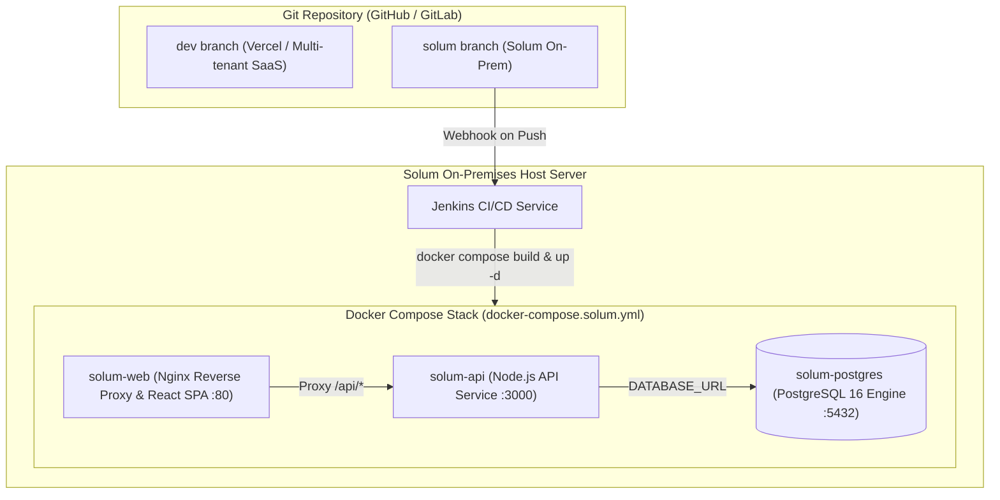

# Solum Technologies — On-Premises Deployment & Jenkins CI/CD Guide

This guide describes how the **Solum Technologies** on-premises instance is packaged, hosted, and automatically deployed via Jenkins whenever changes are pushed to the `solum` branch.

---

## 1. Architecture Overview

While multi-tenant Assetly is hosted on Vercel with serverless edge functions and cloud databases, **Solum Technologies** requires an isolated on-premises deployment on their private infrastructure.



### Components

| Service | Technology | Port | Purpose |
|---|---|---|---|
| **solum-web** | Nginx Alpine | Host `80` (or `${SOLUM_PORT}`) | Serves compiled React SPA and proxies `/api/*` requests to `solum-api` |
| **solum-api** | Node.js 20 Alpine | Container `3000` | Executes Assetly REST API routes (`api/`), business logic, and security agent endpoints |
| **solum-postgres** | PostgreSQL 16 Alpine | Host `5432` (or `${POSTGRES_PORT}`) | Dedicated persistent database; automatically runs seed migrations on first initialization |
| **Jenkins** | Jenkins Server | Host `8080` | Listens for push events on the `solum` branch and executes continuous deployment |

---

## 2. On-Premises Host Prerequisites

Ensure the following tools are installed on the Solum on-premise Linux/Windows host:

1. **Docker Engine & Docker Compose (v2.20+)**
   ```bash
   docker --version
   docker compose version
   ```
2. **Jenkins** installed and running on the host.
3. **Grant Jenkins user Docker privileges**:
   ```bash
   sudo usermod -aG docker jenkins
   sudo systemctl restart jenkins
   ```
4. **Curl / Git / Bash utilities** available to the Jenkins agent.

---

## 3. Jenkins Pipeline Setup

### Step 1: Create the Jenkins Pipeline Job
1. Open Jenkins dashboard (`http://<your-server-ip>:8080`).
2. Click **New Item** → Enter name (e.g., `assetly-solum-deploy`).
3. Select **Pipeline** and click **OK**.

### Step 2: Configure Source Code Management (SCM)
In the job configuration page:
1. Scroll down to the **Pipeline** section.
2. Select **Definition: Pipeline script from SCM**.
3. Choose **SCM: Git**.
4. Enter your Git **Repository URL** (e.g., `git@github.com:your-org/assetly.git` or `https://github.com/...`).
5. Select your Jenkins credentials for Git access.
6. Under **Branches to build**, specify:
   ```text
   */solum
   ```
7. Verify **Script Path** is set to `Jenkinsfile`.

### Step 3: Enable Automated Webhook Trigger
1. Under **Build Triggers**, check **GitHub hook trigger for GITScm polling** (or *Generic Webhook Trigger* / *GitLab webhook*).
2. In your Git repository (GitHub / GitLab Settings → Webhooks):
   - **Payload URL**: `http://<your-server-ip>:8080/github-webhook/`
   - **Content type**: `application/json`
   - **Events**: Select *Just the push event*.
3. Whenever any engineer commits or merges code into the `solum` branch, Jenkins immediately starts the build and deploys.

---

## 4. Environment Configuration (`.env.solum`)

Before running or deploying the first time, review `.env.solum` in the project root:

```bash
cp .env.solum.example .env.solum
```

Key environment settings:

| Variable | Default | Description |
|---|---|---|
| `SOLUM_PORT` | `80` | Port where users access the app in their web browser |
| `POSTGRES_USER` | `solum_admin` | Database username |
| `POSTGRES_PASSWORD` | `...` | Secure database password |
| `POSTGRES_DB` | `assetly_solum` | Database name |
| `JWT_SECRET` | `...` | Cryptographic secret for signing session tokens |
| `AGENT_SECRET` | `...` | Secret key for Endpoint Security agent telemetry |
| `DEMO_AUTH_ENABLED` | `false` | Disables demo accounts for live enterprise use |

---

## 5. Manual CLI Operations (Useful Runbook)

If you need to manually manage the stack on the on-prem server:

### Start or Update Stack
```bash
docker compose -f docker-compose.solum.yml --env-file .env.solum up -d --build
```

### View Live Container Logs
```bash
# All containers
docker compose -f docker-compose.solum.yml logs -f

# API container only
docker compose -f docker-compose.solum.yml logs -f solum-api
```

### Check Container Status & Health
```bash
docker compose -f docker-compose.solum.yml ps
```

### Stop Stack
```bash
docker compose -f docker-compose.solum.yml down
```

---

## 6. Database Backups & Restore

### Create a Database Backup
```bash
docker exec -t solum-postgres pg_dump -U solum_admin -d assetly_solum > solum_backup_$(date +%Y%m%d_%H%M%S).sql
```

### Restore a Database Backup
```bash
cat solum_backup_20261014.sql | docker exec -i solum-postgres psql -U solum_admin -d assetly_solum
```

---

## 7. Workflow: Making Changes for Solum

1. Check out the `solum` branch:
   ```bash
   git checkout solum
   ```
2. Pull latest upstream updates or merge from `dev` if needed:
   ```bash
   git merge dev
   ```
3. Commit Solum-specific adjustments (branding, tenant configs, internal integrations):
   ```bash
   git add .
   git commit -m "feat(solum): customize dashboard for on-prem compliance"
   git push origin solum
   ```
4. **Jenkins automatically triggers**, executes the pipeline, verifies health, and updates the on-prem deployment with zero hassle.
